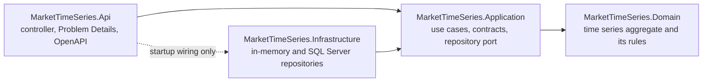

# Electricity Market Time Series API


A small REST API in C# and ASP.NET Core (.NET 10) for managing electricity market time series: production, consumption and cross-border flows between the Nordic bidding zones. It supports create, read, update and delete, and filtering by bidding zone and time interval. Built as a take-home assignment.

## Quick start

**Prerequisites:** [.NET 10 SDK](https://dotnet.microsoft.com/download), and Docker (Docker Desktop or another Docker-compatible engine) for SQL Server. No Docker? See [Quick run without Docker](#quick-run-without-docker).

```bash
git clone https://github.com/canberkileri/electricity-market-timeseries-api.git
cd electricity-market-timeseries-api

docker compose up -d                            # SQL Server 2025, Developer edition
dotnet run --project src/MarketTimeSeries.Api   # http://localhost:5080, stored in SQL Server
dotnet test                                     # all tests; the SQL Server ones need Docker
```

On first start the API creates the tables and adds three sample series for the current UTC day. Data survives restarts in a Docker volume (`docker compose down -v` removes it). On Apple Silicon, turn on Rosetta in Docker Desktop.

Then open:

- **Scalar (interactive API docs):** `http://localhost:5080/scalar`
- **OpenAPI document and health check:** `/openapi/v1.json` and `/health`
- **Ready-made requests:** [`src/MarketTimeSeries.Api/TimeSeries.http`](src/MarketTimeSeries.Api/TimeSeries.http), every operation in order, including the `400`, `409` and `412` cases

### Quick run without Docker

```bash
dotnet run --project src/MarketTimeSeries.Api --launch-profile inmemory   # same API, data kept in memory
```

Nothing else to install: the same API and sample series, lost on restart. `dotnet test` works without Docker too; the SQL Server tests are then skipped.

## API overview

| Operation | Request | Success | Errors |
|---|---|---|---|
| Create | `POST /api/v1/time-series` | `201` with `Location` and `ETag` | `400`, `409` |
| Get | `GET /api/v1/time-series/{id}` | `200` with `ETag` | `404` |
| Search | `GET /api/v1/time-series?biddingZone=&type=&from=&to=&page=&pageSize=` | `200`, paged | `400` |
| Update | `PUT /api/v1/time-series/{id}`, optional `If-Match` | `200` with new `ETag` | `400`, `404`, `409`, `412` |
| Delete | `DELETE /api/v1/time-series/{id}`, optional `If-Match` | `204` | `400`, `404`, `412` |

A request sends `start`, `resolution` and one value per period; the response adds `id`, `end`, `version` and calculated `points`. All errors are [RFC 9457 Problem Details](https://www.rfc-editor.org/rfc/rfc9457). Examples and every rule are in [docs/api.md](docs/api.md).

## Architecture

A pragmatic Clean Architecture with four thin projects; dependencies point inward, so the domain knows nothing about HTTP or storage. The dashed arrow is the one exception: `Program.cs` registers the storage, while controllers and use cases see only the repository interface. The SQL Server tables are drawn in [decision 4](docs/decisions.md#4-storage-sql-server-with-an-in-memory-option).



Tests live in `tests/` (unit and integration); design notes in `docs/`.

## Design decisions

Recorded in a short ADR format in [docs/decisions.md](docs/decisions.md):

1. Clean Architecture, four thin projects.
2. A series is a header plus `start`, `resolution` and `values`, as in ENTSO-E.
3. UTC only; half-open intervals `[from, to)`.
4. SQL Server with the rules in the schema; in memory for runs without Docker.
5. Overlapping series with the same identity: `409`.
6. Optimistic concurrency with `ETag` and `If-Match`.
7. Problem Details for every error; expected failures are results, not exceptions.
8. Grow SQL Server first; move only when a load test says so.

The domain research behind them is in [docs/domain-notes.md](docs/domain-notes.md).

## Assumptions

- **Zones:** the 12 Nordic bidding zones (NO1 to NO5, SE1 to SE4, FI, DK1, DK2) by short code.
- **Types:** `Production`, `Consumption`, `CrossBorderFlow`. A flow goes from `biddingZone` to `toBiddingZone`; a negative value means the reverse direction. Searching by zone returns flows at either end.
- **Unit and resolution:** MW (average power per period); `PT15M` or `PT60M`.
- **Time:** UTC only (`Z`), with `start` aligned to the resolution.
- **Values:** 1 to 35,136 per series (a leap year of quarter-hours), no gaps, at most 3 decimal places and at most 1,000,000 MW in size; production and consumption are zero or positive.
- **Search:** `from` and `to` together, at most 31 days; returned points are clipped to the window, and a search without a window returns series without points; pages of 50 by default, 200 at most.
- **Updates:** `PUT` replaces the period and values; the identity (type, zones, resolution) is fixed.
- **Security:** 1 MB request limit (`413`), no server header, `nosniff`, no internal details in errors; no authentication, since this is an assignment.

## Testing

`dotnet test` runs both suites, and GitHub Actions runs them on every push and pull request to `main`.

- **Unit tests:** domain rules (alignment, flow direction, value rules, overlap, clipping, versioning), search parameter rules and the SQL Server schema.
- **Integration tests:** the real HTTP pipeline through `WebApplicationFactory`, every operation including its error cases, and a `500` that reveals nothing internal. One repository contract runs against both stores (SQL Server via Testcontainers), including twenty parallel overlapping writes where exactly one wins. Without Docker the SQL Server tests are skipped; in CI they always run.

## What I would do next

1. **Production storage:** EF Core migrations run by the pipeline; bulk inserts, partitions and columnstore as data grows ([decision 8](docs/decisions.md#8-beyond-sql-server)).
2. **Revisions:** keep corrected versions of a series instead of overwriting them.
3. **Security:** the organisation's identity provider, with read and write roles.
4. **Observability:** OpenTelemetry metrics and traces into Prometheus and Grafana.
5. **Deployment:** container image on Kubernetes through GitOps, with separate liveness and readiness checks.
6. **Events:** publish `TimeSeriesUpdated` through an outbox, so consumers react instead of polling.
7. **Standards:** ENTSO-E / CIM import and export, EIC codes for areas.
